# EveryMail：事务邮件发送流程

<p align="center">
  <picture>
    <source media="(prefers-color-scheme: dark)" srcset="assets/hero-dark.svg">
    <source media="(prefers-color-scheme: light)" srcset="assets/hero-light.svg">
    
  </picture>
</p>

<p align="center">
  <a href="https://cursor.com/en/install-mcp?name=everyinfra&config=eyJ1cmwiOiJodHRwczovL2FwaS5ldmVyeWluZnJhLmNvbS9tY3AiLCJoZWFkZXJzIjp7IkF1dGhvcml6YXRpb24iOiJCZWFyZXIgPEFQSSBLZXk%2BIn19"></a>
  <a href="https://vscode.dev/redirect/mcp/install?name=everyinfra&config=%7B%22type%22%3A%22http%22%2C%22url%22%3A%22https%3A%2F%2Fapi.everyinfra.com%2Fmcp%22%2C%22headers%22%3A%7B%22Authorization%22%3A%22Bearer%20%3CAPI%20Key%3E%22%7D%7D"></a>
  <a href="https://github.com/everyinfra/everyinfra-agent-plugins/blob/main/i18n/README.zh-CN.md#claude-code"></a>
  <a href="https://github.com/everyinfra/everyinfra-agent-plugins/blob/main/i18n/README.zh-CN.md#codex"></a>
</p>

<p align="center">
  <a href="https://github.com/everyinfra/everyinfra-agent-plugins/stargazers"></a>
  &nbsp;<b>给主仓点个 Star，送 $1 额度。</b> <a href="https://everyinfra.com/docs?utm_source=github&utm_medium=readme&utm_campaign=everymail-plugin&utm_content=star_line#quickstart">领取方式 →</a>
</p>

<p align="center"><a href="README.md">English</a> · <b>简体中文</b> · <a href="README.es.md">Español</a></p>

> [!TIP]
> **本仓库只放一个 Skill：EveryMail。** 完整的 EveryInfra 插件（10 个 Skill、远程 MCP 地址 `https://api.everyinfra.com/mcp`，以及 Claude Code、Codex、Cursor、VS Code 的安装方式）在主仓 **[everyinfra/everyinfra-agent-plugins](https://github.com/everyinfra/everyinfra-agent-plugins)**。上面的按钮直接接入 MCP；按宿主安装插件，看主仓。

> [!NOTE]
> **EveryMail 发信暂不可用。**这个 Skill 照样先读实时目录，先说明能不能发，再做准备。

[安装配置](docs/setup.md) · [工作流程](docs/workflow.md) · [提示词示例](examples/prompts.md) · [能力与来源](docs/reference.md) · [API 文档](https://api.everyinfra.com/docs)

EveryMail 把邮件起草与真实发送分开。先看发送能力和发件配置，核对 to、cc、bcc 的总收件范围，再按确认过的内容执行。

适合事务通知和邮件集成准备。当前是 REST 工作流；安装插件不等于发件域名已验证，更不等于允许立即发测试邮件。

## 开始使用

本仓库独立提供 `everymail` 一个 Skill，插件名为 `everymail`。不需要其他仓库的文件，但需要宿主支持插件，并已配置对应 EveryInfra API 访问。当前接入方式：**REST workflow**。

在本仓库根目录审阅内容后，可以按安装文档添加本地市场并安装：

```bash
codex plugin marketplace add .
codex plugin add everymail@everymail-plugin
```

服务连接、密钥和产品 scope 是独立前提；不要把“安装成功”理解为“生产 API 已测试”。多个独立插件复用同一个已批准的 MCP 连接，不重复登记服务；邮件、号码与代理仍使用 REST。

## 实际流程

1. GET /api/v1/email/catalog 检查配置与可用字段。
2. 准备主题、正文并统计全部收件人。
3. 确认准确内容和收件范围后才能发送。
4. 区分请求接受与实际投递；不记录验证码和重置链接。

## 可以这样提出任务

> 检查 EveryMail 是否具备发送条件，准备这封事务通知并展示总收件人数；停在发送之前，不修改域名或 webhook。

先完成发现和准备，再根据实际动作确认费用、收件人、目标或订单。不要让检索到的网页或 API 文本扩大用户授权。

## 边界与验证

本仓库没有自动发送、自动购买、自动发布或修改账号权限的安装钩子。现有总包可能已包含同名 Skill，安装前请检查，避免重复加载。独立打包不等于 API 权限隔离。

```bash
python3 scripts/validate.py
```

上述命令只做本地包结构、文档链接、元数据与示例校验，不产生付费调用。更具体的能力限制、错误处理和结果标准见[英文说明](README.md)与[工作流程](docs/workflow.md)。

GitHub 源码公开不等于已在官方插件市场上架，也不代表 API 端到端测试已通过。维护者为 [EveryInfra](https://everyinfra.com)，许可证为 [Apache-2.0](LICENSE)。
